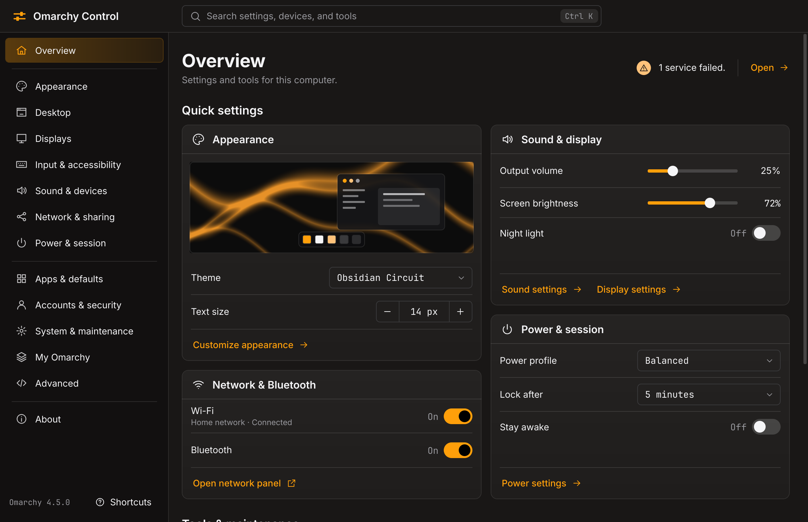
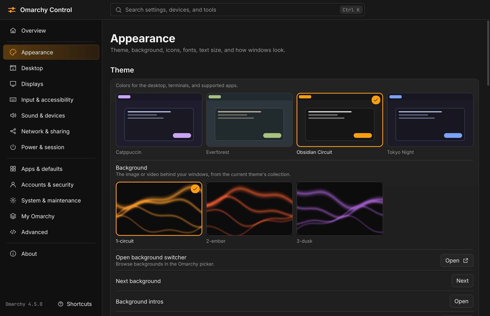
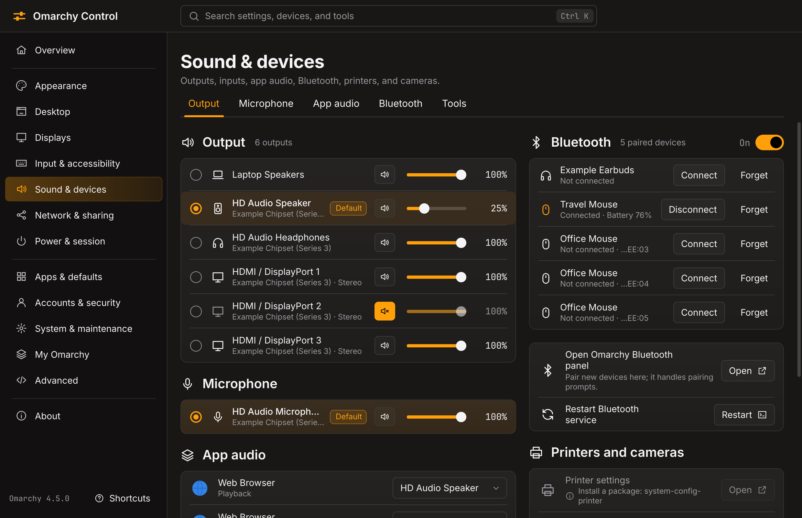
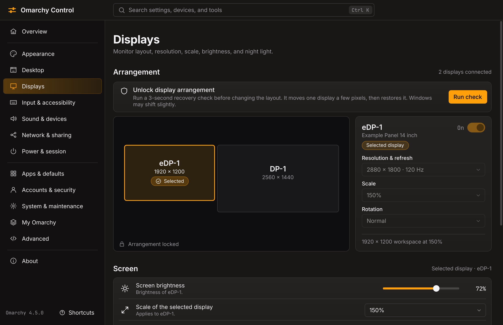
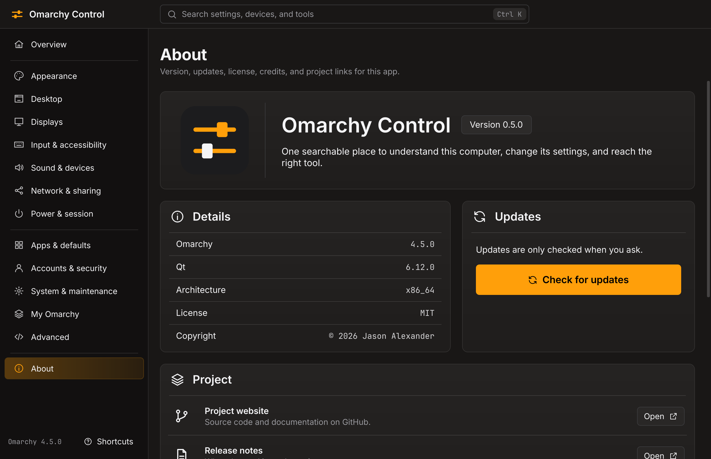

<div align="center">


# Omarchy Control

**One searchable place to understand your Omarchy computer, change its settings, and reach the right tool.**

[](https://github.com/last-refuge/omarchy-control/releases/latest)
[](https://omarchy.org)
[](https://www.qt.io)
[](LICENSE)

[Install](#install) · [Features](#features) · [Safety](#how-changes-stay-safe) · [Shortcuts](#keyboard-shortcuts) · [Command line](#command-line) · [Development](#development)

<br>



</div>

<br>

Omarchy Control is a native app that puts your settings behind one search box. It follows your Omarchy theme and language, in all 50 of the languages Omarchy ships, reuses Omarchy's own commands, and confirms each change by reading the value back. Anything that can be undone has an undo.

## Install

```sh
curl -fsSL https://raw.githubusercontent.com/last-refuge/omarchy-control/main/install.sh | bash
```

This downloads the prebuilt package from [GitHub Releases](https://github.com/last-refuge/omarchy-control/releases), checks it against the release's checksums, and installs it with `pacman`, which shows you the change and asks before going ahead. Nothing is compiled, and nothing in your configuration changes.

Then find it in your app launcher, or run:

```sh
omarchy-control open
omarchy-control integrate menu   # Optional: adds it to the Omarchy menu
```

The first change to a Hyprland setting asks before adding one marked line to `hyprland.lua`.

<details>
<summary><b>Update, uninstall, and other install options</b></summary>

<br>

**Update:** open **About** and choose **Check for updates**, or use the command line. The app only contacts GitHub when you ask it to.

```sh
omarchy-control update            # Is a newer version out?
omarchy-control update install    # Download, verify, and install it
```

**Uninstall:**

```sh
omarchy-control integrate menu --remove   # If you added it to the menu
omarchy-control icons remove-integration  # If you chose an icon pack; removes the launcher icons and hooks, keeps the icons as they are
sudo pacman -R omarchy-control
```

**Install a specific version, or without a terminal:**

```sh
curl -fsSL https://raw.githubusercontent.com/last-refuge/omarchy-control/main/install.sh | bash -s -- --version 0.1.0
curl -fsSL https://raw.githubusercontent.com/last-refuge/omarchy-control/main/install.sh | bash -s -- --yes
```

**Prefer to read it first?** The installer is [one short script](install.sh).

Packages are built for x86_64 by [a public workflow](.github/workflows/release.yml). The checksums protect against a corrupted download. They are published in the same release as the package, so they don't protect against a compromised GitHub account.

</details>

## Features

<table>
<tr>
<td width="50%" valign="top">
<br><br>
<b>See a theme before you pick it</b><br>
Themes, backgrounds, and icon packs are tiles, not filenames. Install a pack you downloaded by dropping in its folder, or the .zip or .tar it came in. Removing one moves it to the Trash, and undo brings it back. Your pack reaches Omarchy's launcher and dock too, which otherwise mix icons from every installed pack, using an idea from [Iconic](https://github.com/UnderStackDev/omarchy_iconic). Blur behind Glassy windows and the bar has its own strength, brightness, color, and grain. The same live, verified settings cover fonts, windows, the bar and dock, idle timers, power profiles, input, DNS, and language.
</td>
<td width="50%" valign="top">
<br><br>
<b>Your devices</b><br>
Sound routing and volume, Bluetooth, and Wi-Fi, with each app's audio output in one list.
</td>
</tr>
<tr>
<td width="50%" valign="top">
<br><br>
<b>Display arrangement with a safety timer</b><br>
If a new layout leaves you without a usable screen, the previous one comes back on its own.
</td>
<td width="50%" valign="top">
<br><br>
<b>Updates when you ask</b><br>
Check for a new version and install it from the About page, where <code>pacman</code> and <code>sudo</code> handle the rest in a terminal.
</td>
</tr>
</table>

**My Omarchy** keeps what makes this computer yours: the theme and background, the bar and dock, launcher changes, shortcuts, terminal settings, and the apps you installed, saved as versions and published to a private GitHub repository when you ask. On a fresh Omarchy installation, connect that repository and restore it. Every save and every restore shows what it will change first, apps install in a terminal where `pacman` and `sudo` ask, and nothing reaches the network until you press Check GitHub or Publish. [How it works](docs/MY-OMARCHY.md).

Any app can be renamed, given another icon, or hidden from the launcher, through a copy of its launcher that notices package updates and leaves the package's own untouched. It also covers services, startup apps, storage, plugins, shortcuts, window rules, file associations, typed Superwhisper settings, and guided firewall routes. Every other Omarchy workflow is one search away, handing off to the right panel, wizard, app, or config file.

The window follows your theme and language live, works by keyboard alone, and mirrors for right-to-left languages. Its translations were made with AI agents, starting from Omarchy's own, and are open to review by native speakers. While it runs, its icon sits in the bar's tray: closing the window keeps it there, and a click brings the window back to the workspace you are on. Quit from the tray's menu, or with <kbd>Q</kbd>. Without a tray, closing quits. Screenshots use a synthetic machine with fictional values.

### Coverage

| 98 | 22 | 334 | 19 | 22 |
| :---: | :---: | :---: | :---: | :---: |
| native settings and pages | Omarchy panels | guided routes | specialist apps | config files |

Every public Omarchy command and menu row in the 4.5 inventory has a destination or a recorded reason for exclusion, [reported by route](docs/COVERAGE.md).

## How changes stay safe

- **Backed up first.** Every change is journaled and backed up or it does not start. It is then applied and verified by reading it back. A failed check restores the previous file, unless someone has edited that file since.
- **Undo you can trust.** Undo refuses if anything has edited the value since, and is only offered when the old value can really be set again.
- **Crashes lose nothing.** After a crash, nothing is overwritten. The app reports what happened and where the backup is.
- **No shell injection.** Values cross into commands as one argument, never through a shell.
- **Your config stays yours.** Hyprland overrides live in one owned file, `~/.config/hypr/omarchy-control.lua`. A hand edit to it is detected and never overwritten.
- **Display changes can't strand you.** They run under a separate watchdog process that restores the previous layout unless you keep the new one. Arranging displays stays locked until `omarchy-control selftest display` has passed on your computer.
- **Wi-Fi switches can roll back.** They run under a NetworkManager checkpoint where polkit allows one.
- **Omarchy can change underneath it.** If a command behind a setting changes, that setting keeps reading but pauses writing until you review it. `omarchy-control compat` shows what changed.
- **Packages wait their turn.** Package work waits for pacman, and a restore keeps a copy of whatever it replaces.
- **Icon packs are copied, never run.** An import only reads the folder you chose, builds the copy to one side, and moves it into place all at once. Nothing it contains is run or made executable, and no pack is ever replaced.
- **Passwords are never collected.** Joining a secured network goes to Omarchy's panel, and installing an update leaves the password prompt to `sudo`.

> [!NOTE]
> **Version 0.4.0, built against Omarchy 4.5 and Hyprland 0.56.** 60 of 76 writable settings, display recovery, and the real window are verified against real Hyprland, the real shell, and real Omarchy scripts in an isolated nested session, and every setting reads correctly on real hardware. The checklist of changes on a real desktop session is still open. [What has and has not been verified](docs/LIVE-CHECKS.md) has the details.

## Keyboard shortcuts

| Key | Action |
| :--- | :--- |
| <kbd>Ctrl</kbd> <kbd>K</kbd> or <kbd>Ctrl</kbd> <kbd>F</kbd> | Search |
| <kbd>Tab</kbd> or <kbd>Shift</kbd> <kbd>Tab</kbd> | Move between controls |
| <kbd>Space</kbd> | Activate the focused control |
| <kbd>Alt</kbd> <kbd>Left</kbd> | Go back |
| <kbd>Ctrl</kbd> <kbd>Z</kbd> | Undo the last change that can be undone |
| <kbd>Ctrl</kbd> <kbd>Shift</kbd> <kbd>Z</kbd> | Redo |
| <kbd>Esc</kbd> | Close a dialog, this list, or search |
| <kbd>?</kbd> | Show shortcuts |
| <kbd>Q</kbd> or <kbd>Ctrl</kbd> <kbd>Q</kbd> | Quit, including from the tray |

Single-letter keys switch off while you are typing.

## Command line

Agents and scripts get the same validation and journal as the window. Each command takes `--json` and exits 0 or 1.

```sh
omarchy-control search "stop sleeping"
omarchy-control get power.idle.lock
omarchy-control plan power.idle.lock 600
omarchy-control apply power.idle.lock 600
omarchy-control history
omarchy-control undo <transaction>
```

<details>
<summary><b>More commands</b></summary>

<br>

```sh
omarchy-control doctor
omarchy-control coverage --live
omarchy-control compat
omarchy-control shortcut add "SUPER + ALT + Y" "My tool" my-tool
omarchy-control rule add firefox float
omarchy-control display preview DP-1 1920 0 --keep
omarchy-control launch panel.network
omarchy-control icons list
omarchy-control icons import ~/Downloads/SomePack.tar.gz
omarchy-control apps launcher set firefox.desktop --name Browser --icon web-browser
omarchy-control update check
omarchy-control skill install
omarchy-control profile capture --category appearance --desktop
omarchy-control profile save --message "Laptop"
omarchy-control profile connect --create my-omarchy
omarchy-control profile publish
omarchy-control profile plan --revision published
```

</details>

## Development

Building from source needs `qt6-base`, `qt6-declarative`, `qt6-svg`, and `qt6-wayland`.

```sh
bin/build                  # build/omarchy-control
bin/install                # Build the Arch package from this checkout and install it
bin/test                   # 405 tests; never touches the real desktop
tools/nested-check.py      # Real Hyprland and Omarchy scripts in an isolated session
tools/package-check.sh     # Install, upgrade, and remove in a disposable pacman root
tools/profile-package-check.sh  # Restore apps from a profile with real pacman, in a disposable root
tools/installer-check.sh   # install.sh against real release files in a disposable root
tools/gen-compat.py        # Re-pin commands after reviewing a changed script
bin/coverage               # Regenerates docs/coverage-ledger.json
tools/i18n-report.py       # Translation coverage per language; --check, --prune, --context
tools/i18n-seed.py         # Start a language from Omarchy's own translations
```

Tests run in a temporary root with fake commands. `tools/make-sandbox.sh` builds a synthetic machine, and `tools/screens` screenshots the real QML against it.

To check a layout for translation, write `en-XA` to the sandbox's `~/.config/omarchy/language`. That pseudo-language makes every string accented, about 40% longer, and bracketed, so clipped or untranslated text stands out. [docs/I18N-PLAN.md](docs/I18N-PLAN.md) covers adding a language.

**Releasing:** pushing a version tag tests the code, builds the package, and publishes it.

```sh
tools/set-version.sh 0.4.0
git commit -am "Release 0.4.0"
git tag v0.4.0
git push origin main v0.4.0
```

Project documents: [plan](docs/PLAN.md), [coverage](docs/COVERAGE.md), [P0 findings](docs/P0-FINDINGS.md), [live checks](docs/LIVE-CHECKS.md).

## License

[MIT](LICENSE). Theme watching and the translator follow Omacut and Monologue (MIT, David Heinemeier Hansson). The interface uses [Inter](https://rsms.me/inter/) ([OFL](src/fonts/Inter-LICENSE.txt)).

Omarchy Control is an independent project and is not an official part of Omarchy.
